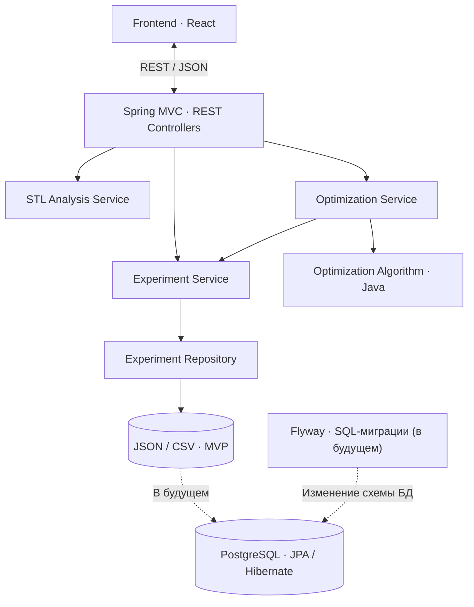

# Backend

 — исследовательский проект по оптимизации параметров 3D-печати, разрабатываемый в рамках подготовки к «Политехнике» МГТУ им. Н. Э. Баумана.

Этот репозиторий содержит серверную часть приложения. Backend предоставляет REST API для frontend-приложения на React, обрабатывает входные данные, анализирует STL-модели и рассчитывает рекомендуемые параметры заполнения на основе результатов физических экспериментов.

Публичный запуск сайта и API с учётом будущего Telegram-бота описан в
[docs/server-launch.md](docs/server-launch.md). Шаблоны Nginx, systemd и окружения
находятся в `deploy/`; перед запуском требуется проверка слайсера на Linux.
Первый проверенный сервер и команды обслуживания — [docs/live-server.md](docs/live-server.md).

## Работа с frontend и расчёт

Текущий интерфейс открывает STL локально. Только кнопка расчёта вызывает `POST /api/optimization/analyze-stl`: файл передаётся в поле `file`, параметры — в отдельных полях multipart. После обработки временный файл не сохраняется в постоянное хранилище. Вращение, масштаб, изменение формы и удаление из просмотра не создают запросов.

Ответ расчёта содержит выбранную экспериментальную конфигурацию, нагрузку с учётом запаса, время, массу, предупреждение о применимости и `experiments` для таблицы и графика. Поля формы соответствуют `OptimizationRequest`; нулевые ограничения времени/массы и нулевые параметры слоя/периметров означают отсутствие ограничения или подбор. В интерфейсе пользователь видит пустые поля с понятными подсказками, а не служебные нули.

Сопоставление с образцом требует отклонения не более 1% отдельно по объёму, площади и каждому габариту. Эти признаки не доказывают одинаковую прочность; предупреждение о границах применения всегда возвращается с результатом. Для приоритета прочности используется измеренная разрушающая нагрузка, если она есть; параметр прочности сжатия не подставляется вместо отсутствующих измерений нагрузки при проверке допустимой нагрузки.

Для проверки есть `printlab-frontend/fixtures/cube-20.stl`: PLA, изгиб, 40 Н, запас 2, слой 0,2 мм, остальные параметры без ограничений → 15% заполнения, 13,74 г, 36 мин, нагрузка с запасом 40,45 Н. При 45 Н выбирается 30% заполнения. При 100 Н данных для допустимого варианта нет.

Коды ошибок 422: `MODEL_NOT_SUPPORTED`, `NO_EXPERIMENTS`, `NO_SUITABLE_CONFIGURATION`. Ошибки параметров возвращают 400 с `INVALID_CALCULATION_INPUT`. Результаты не прогнозируются для произвольной детали и не интерполируются между испытаниями.

Старые endpoints сохранения модели ниже доступны отдельно; текущий frontend их не вызывает. Ранее загруженные модели не удаляются.

## Загрузка STL · SELF-STL

`POST /api/models` принимает `multipart/form-data` с обязательным полем `file` и возвращает `201 Created` с заголовком `Location: /api/models/{id}`. В ответе: `id` (UUID), `fileName`, `sizeBytes`, `triangleCount`, `uploadedAt` (UTC ISO 8601). `GET /api/models/{id}` возвращает сохранённые метаданные с кодом `200`.

Поддерживаются ASCII и бинарный STL до 15 МиБ (15 728 640 байт), без отдельного лимита числа граней. Проверяются структура, конечные координаты с модулем до 10¹² и невырожденность треугольников. Сам STL не задаёт единицы измерения. Проверка замкнутости сетки и пригодности для печати не выполняется.

Файлы хранятся в `data/uploads/{uuid}/model.stl`, метаданные — рядом в `metadata.json`. Каталог исключён из Git. Изменить путь можно переменной `PRINTLAB_MODELS_DIR`; для размещения используйте постоянный диск и резервное копирование этого каталога. Файл и метаданные публикуются одним атомарным переименованием временного каталога на том же диске. При ошибке записи модель не публикуется. После аварийного завершения процесса могут остаться скрытые `.upload-*` каталоги: они не доступны через API и могут быть удалены при остановленном приложении.

Идентификаторы и данные читаются с диска, поэтому переживают перезапуск. Новая загрузка создаёт новый UUID; автоматического устранения дубликатов нет. Удаление, список моделей и скачивание файла в эту фичу не входят. Если ответ потерян после сохранения, повторный POST создаст ещё одну модель.

Ошибки загрузки имеют поля `timestamp`, `status`, `error`, `code`, `message`: `400` — некорректный STL/запрос, `404` — модель не найдена, `413` — превышен размер, `415` — ожидается multipart, `500` — ошибка сервера без технических подробностей. Стабильный `code` позволяет frontend выбрать понятное объяснение: например `DEGENERATE_FACE` — повреждённая грань, `INVALID_STL` — повреждённый формат, `EMPTY_FILE` — пустой файл, `TOO_MANY_TRIANGLES` — слишком подробная модель. `message` содержит причину и действие для пользователя; внутренние диагностические сообщения остаются в журнале сервера. Существующий `POST /api/models/analyze` сохранён и поддерживает оба формата STL.

Запуск с JDK 25:

```sh
./mvnw test
./mvnw spring-boot:run
```

Сервер по умолчанию слушает порт 8080. Frontend должен перенаправлять `/api` на него через Vite proxy при разработке и через веб-сервер при размещении; CORS при таком подключении не требуется. Для ручной проверки:

```sh
curl -i -F 'file=@/path/to/model.stl' http://localhost:8080/api/models
curl http://localhost:8080/api/models/UUID-ИЗ-ОТВЕТА
```

Тесты проверяют оба формата STL, повреждённую структуру, недопустимые координаты, ограничения, ответы API и чтение сохранённых данных новым экземпляром хранилища.

## Для чего нужен backend

Основные задачи серверной части:

- Принимать STL-файлы, проверять их корректность и получать базовые характеристики геометрии.
- Принимать параметры расчёта: материал, условия нагружения, параметры печати и ограничения.
- Получать результаты проведённых экспериментов.
- Подбирать оптимальный процент заполнения **в пределах исследованных моделей и сопоставимых условий испытаний**.
- Возвращать результат и экспериментальные данные для отображения на frontend.


## Технологический стек

**Сейчас:**

- Java 25
- Spring Boot + Spring MVC — REST API
- Maven — сборка и управление зависимостями
- Jackson — сериализация и десериализация JSON
- Lombok — сокращение шаблонного кода
- JUnit 5 — модульное тестирование
- JSON — хранение экспериментальных данных без базы данных на этапе MVP

**Планируется позже:**

- PostgreSQL — постоянное хранение моделей, экспериментов и результатов расчётов
- Spring Data JPA + Hibernate — доступ к данным
- Flyway — версионирование схемы PostgreSQL и применение SQL-миграций
- Выделение самостоятельных модулей и, при необходимости, микросервисов

## Архитектура

На этапе MVP используется **модульный монолит**: одно Spring Boot-приложение с разделением ответственности между компонентами. Отдельные микросервисы пока не нужны.



**Логика работы:**

1. Frontend отправляет STL-файл и параметры расчёта через REST API.
2. Контроллер проверяет запрос и передаёт его соответствующему сервису.
3. Сервис анализа STL определяет базовые характеристики модели и возможность сопоставления с исследованными образцами.
4. Сервис оптимизации получает экспериментальные данные и передаёт их Java-алгоритму.
5. Алгоритм выбирает подходящую экспериментально проверенную конфигурацию с учётом ограничений пользователя.
6. Backend возвращает рекомендацию, данные для сравнения и информацию об ограничениях расчёта.

## Локальный запуск

Необходимы **JDK 25** и **Maven**.

```bash
mvn clean test
mvn spring-boot:run
```

Команды предполагают, что Maven установлен и проект уже содержит стандартную конфигурацию Spring Boot. Для сборки артефакта:

```bash
mvn clean package
```

## Правила работы с Git и Merge Request

В репозитории используются две основные ветки:

- **`main`** — стабильная версия проекта. Прямые коммиты не допускаются.
- **`develop`** — общая ветка разработки, в которую вливаются задачи после проверки.

### Порядок выполнения задачи

1. Выбрать задачу в трекере и ознакомиться с её описанием.
2. Обновить локальную ветку `develop`.
3. Создать **отдельную ветку от `develop`** с номером задачи и кратким названием.
4. Выполнить изменения, проверить сборку и тесты.
5. Отправить свою ветку в удалённый репозиторий.
6. Создать **Merge Request в `develop`**, указав **номер задачи и ссылку на неё**.
7. Дождаться code review, исправить замечания и только затем выполнить merge.

**Оформление Merge Request:**

- **Заголовок:** `[APP-123] Реализовать анализ STL`
- **Source branch:** `feature/APP-123-stl-analysis`
- **Target branch:** `develop`
- **Описание:** ссылка на задачу, краткое описание изменений, способ проверки и при необходимости скриншоты/примеры запросов.

Ссылку на задачу размещаем **в описании MR**; в названии ветки достаточно номера задачи — полноценный URL в имени Git-ветки не нужен.

### Условия принятия MR

- Изменения соответствуют задаче.
- Проект собирается, тесты проходят.
- Новая логика по возможности покрыта JUnit-тестами.
- Отсутствуют случайные изменения и секреты в репозитории.
- MR проверен одним из лидов команды.

Перенос изменений из `develop` в `main` выполняется отдельным MR при подготовке стабильной версии.

### Каталог материалов

Добавлен проверяемый каталог восьми продуктов и 39 механических измерений из паспортов производителей.
`GET /api/materials` отдаёт свойства, параметры печати, методы испытаний и источники с версиями.
Условия напечатанных и литых образцов разделены; каталог не заменяет испытания конкретных деталей.
Порядок пополнения и ограничения — [docs/material-catalog.md](docs/material-catalog.md).

### Подбор печати для произвольного STL

Новый `POST /api/print-plans/analyze-stl` сравнивает шесть реально рассчитанных вариантов
через установленный Bambu Studio для A1 mini с соплом 0,4 мм. Поддержаны PLA, PETG и TPU 95A.
Один одновременный подбор, кеш одинаковых запросов, ограничение времени и очистка временных файлов.
Подробности, параметры установки и границы расчёта — [docs/print-plans.md](docs/print-plans.md).

Размещение в Docker Compose и автодеплой из main: [инструкция](docs/container-deployment.md).
